<link rel="stylesheet" href="pdf-theme.css">

    

        
    

    

        <h2>SensIA - Aplicación web de anonimización</h2>
        <h3>Manual de usuario</h3>
        <h3 class="doc-version">Versión 1.0 · Aplicable a SensIA 1.0.0-rc.1</h3>
    

    

        
    

    

        
        
    

# Índice

<!-- toc -->

- [Control de versiones](#control-de-versiones)
- [1. Introducción](#1-introduccion)
  - [1.1. Cómo funciona](#11-como-funciona)
  - [1.2. Qué detecta SensIA](#12-que-detecta-sensia)
  - [1.3. El documento resultante](#13-el-documento-resultante)
  - [1.4. Objeto de este manual](#14-objeto-de-este-manual)
- [2. Acceso a la aplicación](#2-acceso-a-la-aplicacion)
  - [2.1. Inicio de sesión](#21-inicio-de-sesion)
  - [2.2. Registro y recuperación de contraseña](#22-registro-y-recuperacion-de-contrasena)
  - [2.3. Cierre de sesión](#23-cierre-de-sesion)
- [3. Bandeja de trabajo](#3-bandeja-de-trabajo)
  - [3.1. Subida de archivos](#31-subida-de-archivos)
  - [3.2. Información y estado de los documentos](#32-informacion-y-estado-de-los-documentos)
  - [3.3. Acciones disponibles](#33-acciones-disponibles)
- [4. Revisión y comprobación](#4-revision-y-comprobacion)
  - [4.1. Pantalla de revisión](#41-pantalla-de-revision)
  - [4.2. Revisión de las detecciones](#42-revision-de-las-detecciones)
  - [4.3. Añadir censuras desde el visor](#43-anadir-censuras-desde-el-visor)
  - [4.4. Volver a revisar un documento](#44-volver-a-revisar-un-documento)
  - [4.5. Comparador](#45-comparador)
  - [4.6. Finalización y descarga](#46-finalizacion-y-descarga)
- [5. Repetir el análisis con ajustes específicos](#5-repetir-el-analisis-con-ajustes-especificos)
  - [5.1. Cómo funciona](#51-como-funciona)
  - [5.2. Punto de partida y plantillas](#52-punto-de-partida-y-plantillas)
  - [5.3. Listas de palabras](#53-listas-de-palabras)
  - [5.4. Imágenes y zonas](#54-imagenes-y-zonas)
  - [5.5. Sistema de coordenadas](#55-sistema-de-coordenadas)
- [6. Preferencias de procesamiento](#6-preferencias-de-procesamiento)
  - [6.1. Menú de usuario](#61-menu-de-usuario)
  - [6.2. General](#62-general)
  - [6.3. Detección](#63-deteccion)
  - [6.4. Imágenes y rostros](#64-imagenes-y-rostros)
  - [6.5. Listas y zonas](#65-listas-y-zonas)
  - [6.6. Avanzado](#66-avanzado)
- [7. Administración](#7-administracion)
  - [7.1. Controles globales](#71-controles-globales)
  - [7.2. Gestión de usuarios](#72-gestion-de-usuarios)
- [8. Recomendaciones de uso y limitaciones conocidas](#8-recomendaciones-de-uso-y-limitaciones-conocidas)
  - [8.1. Recomendaciones](#81-recomendaciones)
  - [8.2. Limitaciones conocidas](#82-limitaciones-conocidas)
  - [8.3. Ejemplo completo de trabajo](#83-ejemplo-completo-de-trabajo)
  - [8.4. Preguntas frecuentes](#84-preguntas-frecuentes)

<!-- tocstop -->

# Control de versiones

| Versión | Fecha | Descripción de los cambios |
| :--- | :--- | :--- |
| 1.0 | 01/10/2026 | Primera edición pública, aplicable a SensIA 1.0.0-rc.1. |

# 1. Introducción

Este manual describe el uso de la aplicación web de SensIA (Sensor Inteligente de Anonimización).

La publicación de documentos administrativos, como actas, resoluciones, notificaciones o expedientes, debe compatibilizarse con la protección de los datos personales de las personas que aparecen en ellos. SensIA es una herramienta de apoyo que facilita localizar y ocultar esos datos antes de publicar o compartir un documento.

## 1.1. Cómo funciona

Al subir un documento, SensIA lo analiza y localiza los elementos que pueden contener datos personales: números de identificación, direcciones, cuentas bancarias, nombres, rostros o códigos QR, entre otros. A partir de ahí, el tratamiento depende de si está activada la **vista previa**:

| Modo | Qué ocurre | Cuándo utilizarlo |
| :--- | :--- | :--- |
| **Con vista previa** | SensIA marca los elementos detectados, pero no oculta nada. El documento queda **Pendiente de revisión**: usted comprueba las marcas, desactiva las que no correspondan a datos personales, añade las que falten y confirma. Solo entonces se genera la versión definitiva. | Uso general. Es el modo recomendado. |
| **Sin vista previa** | SensIA oculta directamente los elementos detectados y genera la versión definitiva, que queda **Listo para descargar** sin pasar por la revisión. El resultado puede comprobarse con el comparador antes de descargarlo y, si es necesario, corregirse desde la pantalla de revisión. | Documentos de un modelo conocido cuyas reglas se han comprobado previamente. |

El modo se establece en sus preferencias, con la opción **Vista previa antes de confirmar** (apartado 6.2). Cuando se repite el análisis de un documento desde la pantalla de revisión, el resultado se genera siempre con vista previa (apartado 5).

El trabajo habitual con vista previa sigue estos pasos:

1. Suba el documento en la bandeja de trabajo (apartado 3.1).
2. Espere a que su estado cambie a **Pendiente de revisión**.
3. Pulse **Revisar**, compruebe las detecciones y añada las que falten (apartados 4.1 a 4.3).
4. Pulse **Confirmar** para generar la versión definitiva.
5. Cuando el estado sea **Listo para descargar**, compruebe el resultado con **Comparar** y pulse **Descargar** (apartados 4.5 y 4.6).
6. Elimine el documento de la bandeja de trabajo.

En ambos modos, la versión definitiva se genera ocultando las zonas marcadas y convirtiendo cada página en imagen, de modo que el texto original de esas zonas no se conserva (apartado 1.3).

La decisión sobre qué se oculta corresponde siempre a la persona que revisa el documento. Por eso, incluso sin vista previa, se recomienda comprobar el resultado antes de publicarlo.

Este manual describe la aplicación web. Para integrar SensIA con otras aplicaciones mediante su servicio web, consulte el *Manual del integrador*.

## 1.2. Qué detecta SensIA

En documentos PDF, tanto nativos como escaneados, SensIA puede localizar:

- **Datos identificativos y de contacto:** NIF, NIE, CIF, números de teléfono, correos electrónicos, direcciones, referencias catastrales, y matrículas y bastidores de vehículos, entre otros. El número de afiliación a la Seguridad Social solo se detecta si su instalación lo tiene activado.
- **Datos bancarios:** IBAN y números de tarjeta.
- **Códigos de verificación y localizadores** de documentos.
- **Nombres y apellidos:** mediante un diccionario y, si está disponible en su instalación, mediante un modelo de reconocimiento de entidades que también identifica organizaciones y lugares (apartado 6.3).
- **Rostros** en fotografías e imágenes incrustadas.
- **Códigos QR y códigos de barras.**

Si un documento escaneado no contiene texto, SensIA aplica reconocimiento óptico de caracteres (OCR) antes de la detección.

En las imágenes JPG y PNG, SensIA detecta y oculta rostros. **En las imágenes no se detectan textos ni otro tipo de objetos.**

Además de la detección automática, puede indicar:

- **Palabras o frases que deben ocultarse siempre** (lista negra) y **términos que no deben ocultarse nunca** (lista blanca), como el nombre del propio organismo.
- **Zonas fijas de la página** que deben ocultarse con independencia de su contenido, como las áreas de firma o los sellos de registro.

Estas reglas pueden definirse para todos sus documentos en sus preferencias (apartado 6.5), para un documento concreto al repetir su análisis (apartado 5.4) o, durante la revisión, directamente desde el visor (apartado 4.3).

En lugar de ocultar los datos, también puede sustituirlos por seudónimos (apartado 6.2).

## 1.3. El documento resultante

Ocultar un dato con un rectángulo negro en un editor de PDF convencional no siempre lo elimina: el texto puede seguir presente debajo y copiarse. Para evitarlo, SensIA genera la versión definitiva convirtiendo cada página en imagen. El resultado no contiene capa de texto, capas ocultas ni los metadatos del documento original, y el contenido situado bajo las zonas ocultadas no se conserva.

Como consecuencia, en la versión definitiva no se puede seleccionar ni buscar texto. Si debe publicarse en un formato accesible, será necesario un tratamiento posterior.

SensIA facilita la aplicación de la normativa de protección de datos (RGPD y LOPDGDD), pero no sustituye la valoración de la persona responsable sobre qué datos deben ocultarse en cada caso.

## 1.4. Objeto de este manual

Al terminar la lectura de este manual, podrá:

- Acceder a la aplicación.
- Subir documentos y seguir su estado.
- Revisar y validar las detecciones, y añadir los textos o zonas que deban ocultarse.
- Comparar el documento original con su versión definitiva.
- Aplicar reglas específicas: listas blanca y negra, zonas fijas y zona del logotipo.
- Configurar sus preferencias de procesamiento.
- Descargar la versión definitiva.

# 2. Acceso a la aplicación

Se accede a SensIA desde el navegador web, sin necesidad de instalar ningún programa. Se recomienda utilizar una versión actualizada de Google Chrome o Mozilla Firefox.

## 2.1. Inicio de sesión

Acceda a la dirección facilitada por su servicio de informática (por ejemplo, `https://sensia.tuorganismo.es`). En la pantalla **Iniciar Sesión**, identifíquese:

- **Email:** su dirección de correo electrónico institucional.
- **Contraseña:** la asignada por el administrador o la recibida al registrarse. El icono del ojo permite mostrarla u ocultarla mientras la escribe.
- **Verificación de seguridad:** si aparece la casilla de verificación (ALTCHA), márquela y espere a que se complete. Sirve para impedir accesos automatizados.

Pulse **Entrar**.

Si no es posible acceder, la pantalla indica el motivo:

| Mensaje | Qué hacer |
| :--- | :--- |
| «Usuario o contraseña incorrectos.» | Compruebe los datos introducidos. Si no recuerda la contraseña, solicite una temporal (apartado 2.2). |
| «Tu cuenta está bloqueada. Contacta con soporte.» | Diríjase al administrador de SensIA de su organismo. |
| «La verificación de seguridad es obligatoria.» | Marque la casilla de verificación y espere a que se complete. |
| Aviso de mantenimiento | La aplicación está temporalmente en mantenimiento. Vuelva a intentarlo más tarde. |

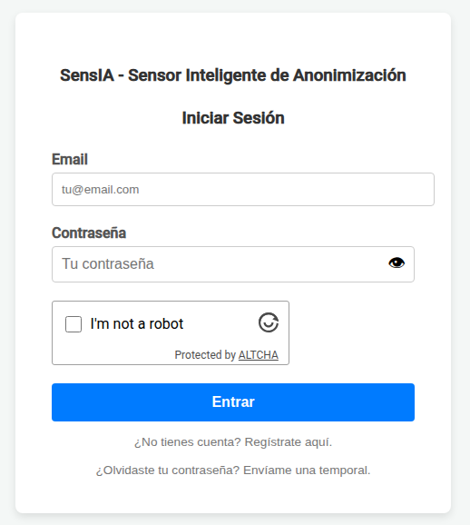

Imagen: Pantalla de inicio de sesión.

## 2.2. Registro y recuperación de contraseña

Debajo del botón **Entrar** pueden aparecer dos enlaces, según la configuración establecida por el administrador.

**Registro.** Pulse **¿No tienes cuenta? Regístrate aquí.** En la pantalla **Crear Cuenta**, indique su correo electrónico, complete la verificación de seguridad si se muestra y pulse **Registrarse**. Recibirá sus credenciales de acceso por correo electrónico. Si la dirección ya está registrada, la aplicación se lo indicará; en ese caso, utilice la recuperación de contraseña.

Tras el primer acceso, se recomienda cambiar la contraseña recibida desde **Mi cuenta** (apartado 6.1).

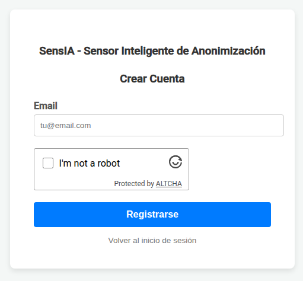

Imagen: Formulario de registro.

**Recuperación de contraseña.** El proceso consta de dos pasos:

1. Pulse **¿Olvidaste tu contraseña? Envíame una temporal.** En la pantalla **Recuperar Contraseña**, indique su correo electrónico, complete la verificación de seguridad si se muestra y pulse **Enviar clave temporal**. Recibirá un correo con un código temporal.
2. En la pantalla **Crear Nueva Contraseña**, indique su correo electrónico, pegue el código recibido en **Código / Clave temporal**, escriba su **Nueva Contraseña**, complete la verificación de seguridad si se muestra y pulse **Guardar y Entrar**. Si el cambio se realiza correctamente, la aplicación vuelve a la pantalla de inicio de sesión, donde podrá entrar con la nueva contraseña.

La nueva contraseña debe tener al menos 12 caracteres.

Si el código no es válido, se mostrará el mensaje «Error al cambiar la contraseña. Revisa el código temporal.». Compruebe que lo ha copiado completo y sin espacios.

En cualquiera de estas pantallas, **Volver al inicio de sesión** le devuelve al formulario de acceso.

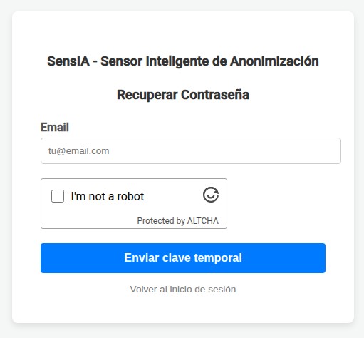

Imagen: Recuperación de contraseña.

## 2.3. Cierre de sesión

Para salir de la aplicación, despliegue el menú de usuario y pulse **Cerrar sesión** (apartado 6.1).

Al cerrar la sesión, o cuando esta caduca, la bandeja de trabajo se vacía automáticamente y se interrumpe el procesamiento que estuviera en curso. Antes de salir, descargue las versiones definitivas que necesite.

# 3. Bandeja de trabajo

Tras iniciar sesión se muestra la bandeja de trabajo, desde la que puede subir documentos, consultar su estado y acceder a las acciones disponibles. Cada usuario ve únicamente sus propios documentos.

Los documentos de la bandeja se conservan en su navegador mientras dura la sesión (apartado 2.3). El análisis continúa aunque cambie de pantalla, por ejemplo, para revisar otro documento o consultar sus preferencias.

## 3.1. Subida de archivos

SensIA admite documentos PDF e imágenes JPG y PNG. El tamaño máximo por archivo lo establece el administrador de la plataforma y se indica bajo el botón de selección, por ejemplo: «PDF, JPG o PNG · hasta 50 MB por archivo». No se admiten documentos PDF cifrados ni protegidos con contraseña.

Para subir archivos:

1. Pulse **+ Seleccionar archivos** y elija uno o varios archivos en su equipo. Para seleccionar varios a la vez, mantenga pulsada la tecla Ctrl mientras los marca.
2. SensIA comprueba cada archivo antes de añadirlo. Si alguno no tiene un formato admitido o supera el tamaño máximo, no se añade y se muestra un aviso con el motivo, por ejemplo: «"acta_pleno.docx": formato no admitido. Solo se aceptan PDF, JPG y PNG.»
3. Los archivos admitidos aparecen en la bandeja y su análisis comienza automáticamente, con o sin vista previa, según sus preferencias vigentes en ese momento (apartado 6).

Mientras haya documentos en proceso, el botón muestra **+ Seleccionar más archivos**: puede seguir añadiendo documentos sin esperar a que terminen los anteriores.

Si en ese momento no pudieran cargarse sus preferencias, no se añade ningún archivo y se le indica que vuelva a intentarlo pasados unos segundos.

Antes de subir un archivo, compruebe que su nombre no contiene datos personales, como el nombre o el NIF de la persona interesada: la versión definitiva se descarga con el mismo nombre, precedido de `CENSURADO_` (apartado 4.6). Por ejemplo, en lugar de `Resolucion_Juan_Perez_12345678Z.pdf`, utilice un nombre como `Resolucion_2026_0457.pdf`.

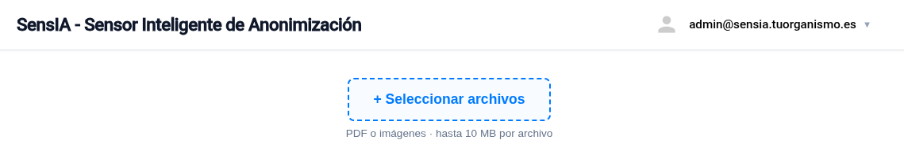

Imagen: Selección de archivos.

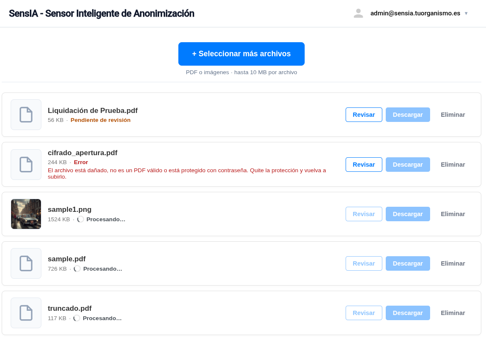

Imagen: Bandeja de trabajo con documentos en distintos estados.

## 3.2. Información y estado de los documentos

Cada documento de la bandeja muestra:

- Una **miniatura**: el icono de PDF o, en las imágenes, una reducción de la propia imagen. Al pulsarla se abre la revisión, igual que con el botón **Revisar**.
- El **nombre** y el **tamaño** del archivo.
- El **estado** del procesamiento.
- Según el caso, un **mensaje de resultado**, un **mensaje de error** o un **aviso**.

| Estado | Significado | Qué hacer |
| :--- | :--- | :--- |
| **Procesando…** | El documento se está enviando o analizando. | Esperar. Puede seguir trabajando con otros documentos. |
| **En cola…** | El servidor ha recibido el documento y lo analizará en cuanto haya capacidad disponible. | Esperar. El estado cambiará a **Procesando…** cuando comience el análisis. |
| **Pendiente de revisión** | Se ha generado la vista previa con las marcas propuestas. Todavía no se ha ocultado nada. | Revisar y confirmar las marcas (apartado 4). |
| **Listo para descargar** | Se ha generado la versión definitiva, tras confirmar la revisión o directamente si se procesó sin vista previa. | Comprobar el resultado con **Comparar** y descargarlo. |
| **Error** | No ha sido posible procesar el documento. Debajo se indica el motivo. | Comprobar que el archivo no está dañado ni protegido con contraseña. Puede volver a intentarlo desde **Revisar**, con **Repetir análisis**, o eliminarlo y subirlo de nuevo. |

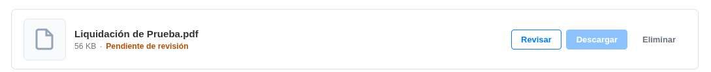

Imagen: Bandeja de documentos.

El estado puede ir acompañado de:

- Un **mensaje de resultado**, en verde: mensaje del servicio al terminar el análisis, por ejemplo, «Procesamiento finalizado.».
- Un **mensaje de error**, en rojo: motivo por el que no se ha podido procesar el documento.
- Un **aviso**, en color ámbar: circunstancia que no ha impedido obtener el resultado, pero que conviene tener en cuenta durante la revisión.

## 3.3. Acciones disponibles

A la derecha de cada documento se muestran los botones de acción:

- **Revisar:** abre la pantalla de revisión (apartado 4.1). No está disponible mientras el documento se procesa. Si en una revisión anterior ya aplicó cambios al documento, la aplicación le pedirá confirmación para empezar de nuevo (apartado 4.4).
- **Comparar:** muestra el documento original junto a su versión definitiva (apartado 4.5). Solo aparece cuando el documento está **Listo para descargar**.
- **Descargar:** descarga la versión definitiva (apartado 4.6). Permanece desactivado hasta que esta se genera; mientras tanto, al situar el puntero sobre el botón se indica «Disponible cuando se confirme la revisión».
- **Eliminar:** quita el documento de la bandeja de inmediato, sin solicitar confirmación. Si el documento estaba en proceso, su análisis deja de seguirse.

Imagen: Documento pendiente de revisión: sin «Comparar» y con «Descargar» desactivado.

Se recomienda eliminar los documentos una vez descargado el resultado, para no conservar copias innecesarias de documentos con datos personales. **La aplicación está diseñada para no almacenar ningún documento en el servidor; aun así, es una buena práctica eliminar de la bandeja y de su equipo los documentos que ya no necesite.**

# 4. Revisión y comprobación

La detección automática puede omitir datos (falsos negativos) o marcar información que no es personal (falsos positivos). Por eso es necesario comprobar el resultado antes de publicar un documento:

- **Con vista previa**, la comprobación se realiza en la pantalla de revisión (apartados 4.1 a 4.3), antes de que se oculte nada.
- **Sin vista previa**, la versión definitiva ya se ha generado. Compruébela con el comparador (apartado 4.5). Si detecta errores, pulse **Revisar**: podrá activar o desactivar detecciones y confirmar de nuevo, añadir textos o zonas desde el visor, o repetir el análisis con otros ajustes (apartado 5).

## 4.1. Pantalla de revisión

En la bandeja, pulse **Revisar** o la miniatura del documento. La pantalla de revisión se divide en dos zonas: el visor del documento, a la izquierda, y el panel de detecciones, a la derecha.

**Barra del visor.** En la parte superior del visor se encuentran:

- Los controles de ampliación (**−**, porcentaje y **+**), entre el 50 % y el 300 %.
- La navegación entre páginas (**◀ Página 1 de N ▶**), en los documentos PDF.
- El botón **Marcar zona**, para ocultar un área de la página (apartado 4.3), en los documentos PDF.
- El selector **Anonimizado | Original**. **Anonimizado** muestra la versión generada por SensIA, con las marcas propuestas o con los datos ya ocultados. **Original** muestra el documento tal como se subió, lo que permite leer el texto que queda bajo las marcas. La opción **Anonimizado** no está disponible mientras el documento no tenga resultado.

Bajo la barra se muestra una breve ayuda sobre las acciones disponibles en el visor y, cuando procede, avisos como «Esa zona ya está entre las censuras fijas de este documento».

**Visor del documento.** Muestra la página actual. En la vista previa, los recuadros rojos indican lo que se ocultará al confirmar, y los verdes, las zonas protegidas, como el logotipo o los términos de la lista blanca.

**Panel de detecciones.** En la parte superior del panel se encuentran:

- El enlace **← Volver**, para regresar a la bandeja de trabajo, y el indicador **Procesando…** mientras SensIA trabaja con el documento.
- Los botones **Repetir análisis** (apartado 5), **Actualizar vista previa** y **Confirmar** (apartado 4.2).
- Los mensajes de resultado, error o aviso del documento, con el mismo significado que en la bandeja (apartado 3.2).
- El título **Detecciones · Pág. N**, el estado de la versión que se muestra (**Vista previa · pendiente de confirmar** o **Versión definitiva**) y el recuento de elementos, por ejemplo, «4 en esta página · 23 en total».

Debajo se relacionan las detecciones de la página actual. Cada una muestra:

- El **texto detectado** o, en las censuras fijas, su identificador (Z1, Z2…) seguido de sus coordenadas X, Y, W, H.
- El **tipo** de detección y, cuando existe, un **subtipo** que precisa la categoría del dato.
- El **número de apariciones** del mismo elemento en el documento, por ejemplo, «En 5 páginas» o «3 veces».
- Un **interruptor** que indica si el elemento se ocultará.

Las imágenes que se eliminan con **Eliminar imágenes** aparecen con el interruptor activado. Si lo desactiva, la imagen se conserva en el documento.

| Tipo en el panel | Significado |
| :--- | :--- |
| **Dato sensible** | Dato detectado por patrones (NIF, dirección, teléfono, IBAN, etc.) o por la lista negra. |
| **Nombre** | Nombre o apellido detectado mediante diccionario. |
| **Entidad** | Persona, organización o lugar detectados por reconocimiento de entidades (NER). |
| **Rostro** | Rostro en una fotografía o imagen. |
| **Código QR** | Código QR o código de barras. |
| **Imagen** | Imagen incrustada en el documento. |
| **Censura fija** | Zona fija de ocultación, definida en las preferencias, al repetir el análisis o desde el visor. Las zonas marcadas en el visor pueden figurar como **Zona del visor**. |

Al situar el puntero sobre el tipo se muestra su código técnico (por ejemplo, `SENSITIVE_DATA` o `NAMED_ENTITY`), útil para comunicar incidencias al servicio de soporte.

El identificador **Zn** de una censura fija corresponde a la zona número n del campo **Censuras fijas** de la ventana **Repetir análisis** (apartado 5.4). Si la zona no figura en ese campo, recibe el número siguiente disponible. Al situar el puntero sobre el identificador se muestra esta explicación.

En las imágenes JPG y PNG, la revisión se limita a los controles de ampliación y al panel de detecciones: no hay navegación entre páginas, selección de texto ni marcado de zonas.

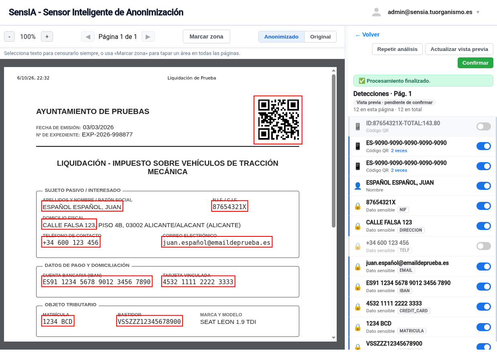

Imagen: Revisión de marcas en un documento de ejemplo.

## 4.2. Revisión de las detecciones

Si el interruptor de una detección está activado (azul), el elemento se ocultará en la versión definitiva. Si el dato no debe ocultarse, desactívelo: la fila se mostrará atenuada.

Los cambios en los interruptores no modifican el documento de inmediato. Para comprobar su efecto, pulse **Actualizar vista previa**: SensIA regenera la vista previa con las marcas activadas y desactivadas, sin volver a analizar el documento. Este botón solo se activa cuando ha cambiado algún interruptor.

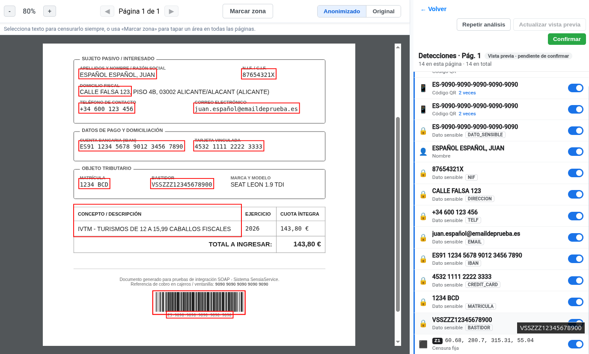

Imagen: Panel de detecciones. Interruptores para activar o desactivar detección.

**Elementos que aparecen varias veces.** Un mismo dato suele repetirse en varias páginas, como el nombre de la persona interesada. Para aplicar el mismo cambio a todas sus apariciones:

- Al cambiar el interruptor de una aparición, si el resto tiene un estado distinto, se muestra un aviso en la esquina inferior derecha que ofrece aplicar el cambio a todas. Pulse la acción del aviso para hacerlo.
- También puede mantener pulsada la tecla **Mayús** mientras pulsa el interruptor: el cambio se aplica directamente a todas las apariciones.
- Tras aplicar un cambio a todas las apariciones, el aviso ofrece la opción **Deshacer** durante unos segundos.

Ejemplo: en una resolución de cinco páginas se detecta el nombre de la jefa de servicio que firma el documento, que debe figurar en la versión publicada. Mantenga pulsada **Mayús** y pulse su interruptor: la detección se desactiva en las cinco páginas. Si ese nombre se repite en otros documentos, añádalo a la lista blanca de sus preferencias (apartado 6.5) para no tener que desactivarlo cada vez.

**Procedimiento recomendado:**

1. **Compruebe cada detección.** Desactive las que no correspondan a datos que deban ocultarse.
2. **Descarte los falsos positivos.** Es habitual que se marquen datos públicos, como la dirección o el teléfono de una oficina de la Administración, o fragmentos de palabras identificados como entidades (por ejemplo, "EL" dentro de "ELCHE"). Si se repiten en sus documentos, añádalos a la lista blanca en lugar de desactivarlos uno a uno.
3. **Valore los códigos QR.** Muchos contienen un enlace con un código seguro de verificación que permite descargar el documento original desde la sede electrónica del organismo emisor. En ese caso deben ocultarse, igual que el código de verificación impreso como texto.
4. **Busque datos no marcados.** Preste especial atención a las tablas, los documentos escaneados, los códigos QR situados junto a otros elementos y el texto dentro de imágenes (apartado 8.2). Si falta algún dato, añádalo desde el visor (apartado 4.3).
5. **Revise todas las páginas.** El panel muestra solo las detecciones de la página actual; utilice la navegación del visor para recorrer el documento completo.
6. **Actualice la vista previa** y compruebe el resultado.
7. **Confirme.** Pulse **Confirmar**. SensIA genera la versión definitiva en segundo plano y le devuelve a la bandeja de trabajo, donde el documento pasará a **Listo para descargar**.

El botón **Confirmar** permanece desactivado mientras haya cambios del visor pendientes de aplicar (apartado 4.3). En un documento procesado sin vista previa, solo se activa si ha modificado alguna detección.

**Salir sin confirmar.** Pulse **← Volver**. Si hay cambios sin aplicar, la aplicación le pedirá confirmación antes de descartarlos. El procesamiento que esté en curso continúa en segundo plano.

Tenga en cuenta que, si sale de la revisión después de haber aplicado cambios, al volver a pulsar **Revisar** el documento se analizará de nuevo desde el principio (apartado 4.4). Por ello, se recomienda completar la revisión y confirmarla antes de volver a la bandeja.

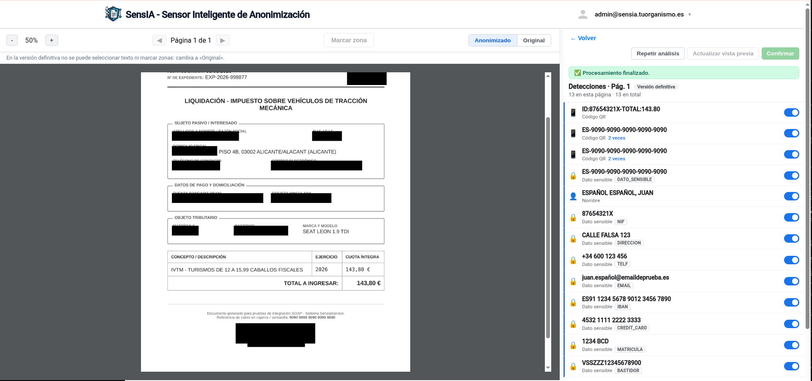

Imagen: Confirmación del documento.

## 4.3. Añadir censuras desde el visor

En los documentos PDF puede indicar directamente en el visor los textos y las zonas que deben ocultarse y que SensIA no ha detectado. Estos cambios se acumulan como **cambios pendientes** y se aplican todos a la vez con un nuevo análisis.

**Ocultar un texto**

1. Seleccione el texto con el ratón en el visor, como lo haría en cualquier documento.
2. Junto a la selección aparece el botón **Censurar siempre «…»**. Púlselo.
3. El texto se añade a los cambios pendientes.

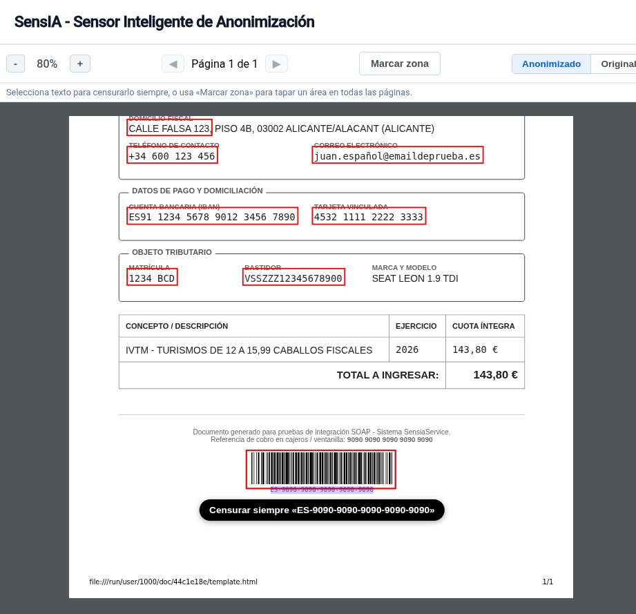

Imagen: Censura de un texto seleccionado en el visor.

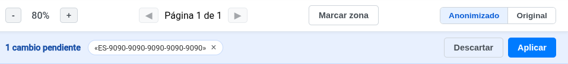

Imagen: Texto en los cambios pendientes".

Al aplicarse, el texto se incorpora a la lista negra de ese documento, por lo que se ocultará en todas sus apariciones, no solo en la seleccionada. Si el texto ya figura en la lista negra, o la selección no puede utilizarse, se muestra un aviso bajo la barra del visor.

En la versión definitiva no se puede seleccionar texto, porque cada página se ha convertido en imagen. En ese caso, cambie el selector del visor a **Original**.

Ejemplo: el número de expediente «2026/001234», que permitiría identificar a la persona interesada, no se ha detectado. Selecciónelo en el visor y pulse **Censurar siempre «2026/001234»**.

**Ocultar una zona**

1. Con el selector del visor en **Original**, pulse **Marcar zona**. El botón no está disponible en la vista **Anonimizado**, porque la posición de la zona debe tomarse sobre el documento original. Para que se active el botón **marcar zona**, debe previamente seleccionar la vista **original**.
2. Trace un rectángulo arrastrando el ratón sobre la página o, si lo prefiere, pulse en dos esquinas opuestas de la zona.
3. La zona se añade a los cambios pendientes y el modo de marcado se desactiva.

Para cancelar el marcado, pulse **Cancelar zona** o la tecla **Esc**.

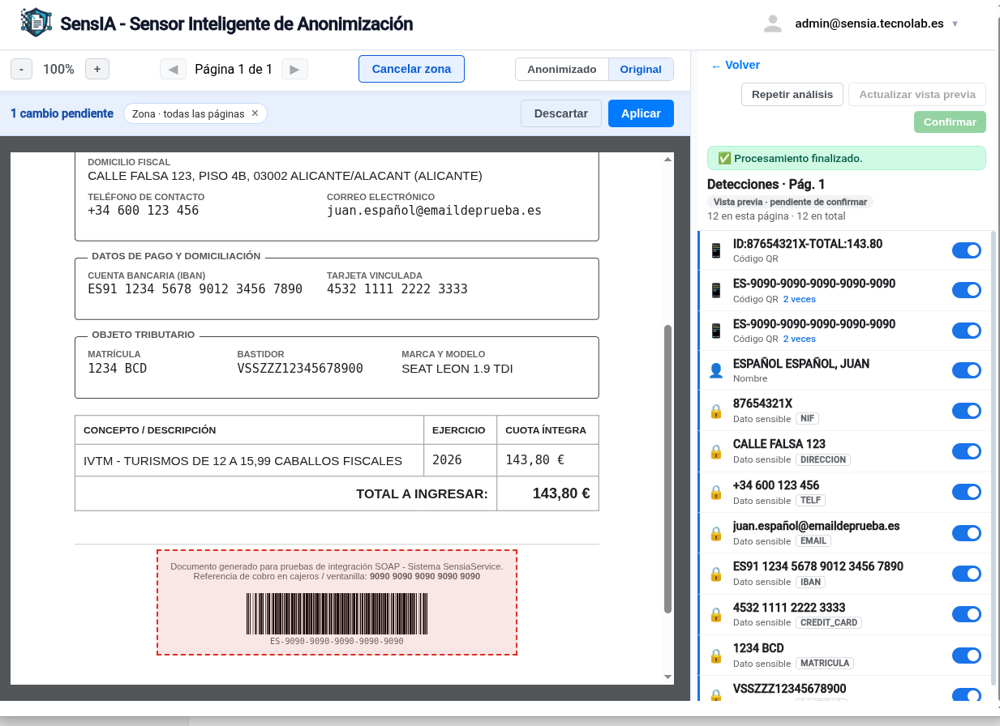

Imagen: Marcado de una zona.

La zona se aplica como censura fija en **todas las páginas** del documento, en la misma posición. Una vez aplicada, puede desactivarla en las páginas en las que no proceda desde el panel de detecciones, donde figura como censura fija con su identificador (Z1, Z2…).

Ejemplo: en la última página de un acta figura, anotado a mano en el margen inferior, el teléfono particular de una persona. Vaya a esa página, pulse **Marcar zona** y trace un rectángulo sobre la anotación. Tras aplicar los cambios, desactive la zona en el resto de páginas desde el panel de detecciones.

**Cambios pendientes**

Mientras haya cambios sin aplicar, bajo la barra del visor se muestra una franja con el número de cambios pendientes y una etiqueta por cada uno. Al situar el puntero sobre una etiqueta se muestra su detalle.

- Para quitar un cambio concreto, pulse **×** en su etiqueta.
- **Descartar** elimina todos los cambios pendientes.
- **Aplicar** vuelve a analizar el documento con los cambios incorporados y conserva las decisiones que haya tomado en el panel de detecciones.

Mientras haya cambios pendientes, el botón **Confirmar** permanece desactivado. Si abre la ventana **Repetir análisis**, los cambios pendientes se muestran ya incorporados a los ajustes del documento; si la cierra sin aceptar, siguen pendientes.

Los textos y zonas añadidos desde el visor solo afectan a ese documento. Si deben aplicarse a todos sus documentos, añádalos a sus preferencias (apartado 6.5).

La tecla **Esc** cancela el marcado de una zona, oculta el botón **Censurar siempre** de una selección y cierra los avisos del panel.

## 4.4. Volver a revisar un documento

Si sale de la revisión sin haber aplicado ningún cambio, al pulsar de nuevo **Revisar** se abre la revisión con el último resultado del documento.

Si en la revisión anterior aplicó cambios al documento (con **Actualizar vista previa**, **Aplicar**, **Repetir análisis** o **Confirmar**), al pulsar de nuevo **Revisar** la aplicación le solicitará confirmación con el siguiente mensaje:

*«Se descartarán los cambios de la revisión anterior de "nombre del documento" y el documento se volverá a analizar desde el principio. ¿Desea continuar?»*

- Si acepta, el documento se analiza de nuevo como si acabara de subirlo, con sus preferencias vigentes y sin los ajustes ni las decisiones de la revisión anterior, y se abre directamente la pantalla de revisión. Mientras dura el análisis se muestran el documento original y el indicador **Procesando…**; al terminar, aparecen las nuevas detecciones.
- Si cancela, el documento se mantiene sin cambios.

Esta opción resulta útil cuando la revisión anterior se ha complicado o cuando ha modificado sus preferencias y desea aplicarlas al documento desde el principio.

## 4.5. Comparador

Cuando un documento está **Listo para descargar**, en la bandeja aparece el botón **Comparar**. Al pulsarlo se abre, a pantalla completa, la vista **Comparación**, con el nombre del archivo y dos paneles:

- **Original** (izquierda): el archivo tal como se subió.
- **Anonimizado · definitivo** (derecha): la versión definitiva, con los elementos ocultados.

En la cabecera de cada panel se indica el número de páginas y se dispone de botones para girar las páginas de ese panel a la izquierda o a la derecha.

La barra superior contiene:

- **← Volver a la lista**, para regresar a la bandeja. También puede pulsar la tecla **Esc**.
- Los controles de ampliación (**−**, porcentaje y **+**), que se aplican a los dos paneles. Pulse sobre el porcentaje para volver al 100 %.
- **Girar ambos**, que gira 90° las páginas de los dos paneles a la vez.
- El interruptor **Desplazamiento sincronizado**. Si está activado, que es la opción predeterminada, al desplazarse por un documento el otro le sigue y muestra la misma zona. Desactívelo si necesita recorrer cada documento por separado.

Si el original y la versión definitiva no tienen el mismo número de páginas, se muestra un aviso y la sincronización del desplazamiento será aproximada.

En el modo sin vista previa, el comparador es la forma de comprobar el resultado antes de descargarlo. En ambos modos resulta especialmente útil para revisar fotografías y documentos complejos. Durante la revisión, el selector **Anonimizado | Original** del visor ofrece una comparación equivalente, página a página (apartado 4.1).

Ejemplo: para comprobar que se han ocultado todos los rostros de una fotografía de un acto público, abra el comparador, amplíe al 200 % y recorra la imagen. El panel derecho sigue automáticamente al izquierdo, lo que permite verificar que no queda ninguna persona sin pixelar en segundo plano.

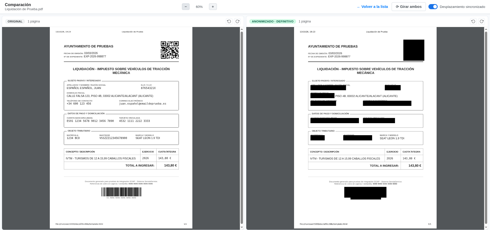

Imagen: Comparación de un documento con su versión definitiva.

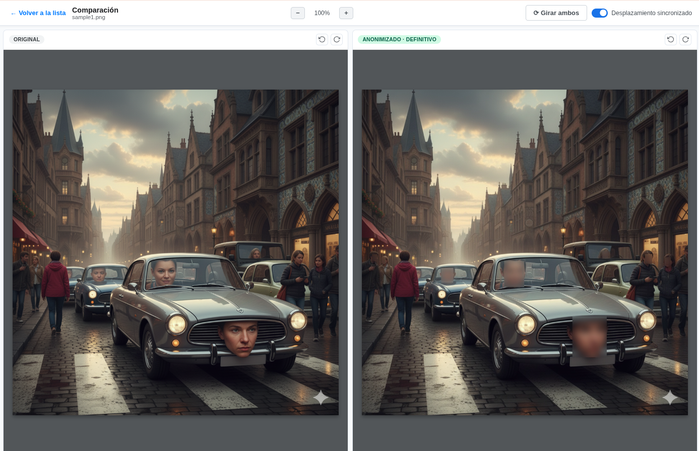

Imagen: Comparación de una fotografía de ejemplo con los rostros ocultados.

## 4.6. Finalización y descarga

La versión definitiva se genera al confirmar la revisión o, en el modo sin vista previa, directamente tras el análisis. En ambos casos, el documento pasa a **Listo para descargar** y se activa el botón **Descargar**.

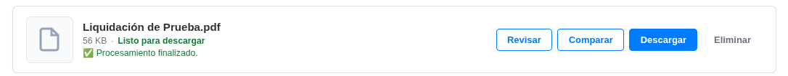
Imagen: Descarga del documento.

Pulse **Descargar**. Se mostrará el aviso **Descarga de documento anonimizado**, con el nombre del archivo. Al aceptarlo, usted confirma que ha revisado y validado los criterios de protección aplicados, y se inicia la descarga.

El archivo se descarga con el nombre original precedido de `CENSURADO_`. Por ejemplo, `Resolucion_2026_0457.pdf` se descarga como `CENSURADO_Resolucion_2026_0457.pdf`.

Antes de publicar el documento, se recomienda comprobarlo con el comparador (apartado 4.5). Las características de la versión definitiva se describen en el apartado 1.3.

Una vez descargado, elimine el documento de la bandeja si ya no lo necesita.

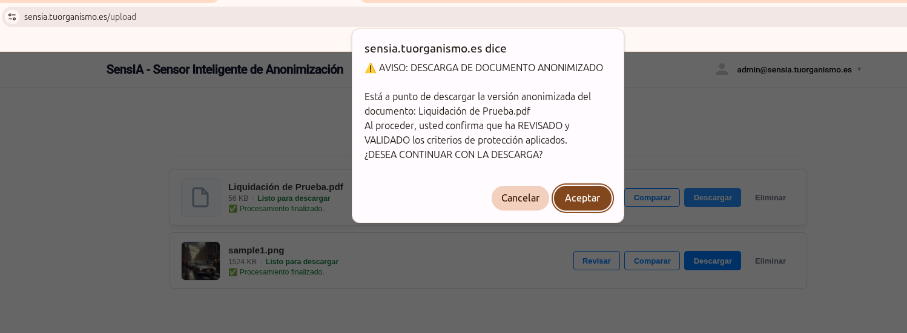

Imagen: Confirmación de la descarga.

# 5. Repetir el análisis con ajustes específicos

Puede volver a analizar un documento con otros ajustes cuando la configuración aplicada no resulta adecuada para él. Por ejemplo, si se ha ocultado el nombre del propio organismo, si no se ha cubierto el área de firma o si el documento sigue un modelo para el que conviene utilizar una plantilla.

## 5.1. Cómo funciona

En la pantalla de revisión, pulse **Repetir análisis**. Se abrirá la ventana del mismo nombre, que contiene únicamente los **ajustes propios del documento**:

- Las listas de palabras **Censurar siempre (lista negra)** y **No censurar nunca (lista blanca)** (apartado 5.3).
- **Eliminar imágenes**, **Censuras fijas** y **Zona del logotipo** (apartado 5.4).

El resto de opciones se toma de sus preferencias vigentes en el momento del análisis (apartado 6). Entre ellas están la vista previa, los tipos de datos que se detectan, el reconocimiento de entidades, los rostros, los seudónimos, el grosor del tachado, la preservación del logotipo y los parámetros avanzados.

Al abrir la ventana se muestran los ajustes actuales del documento, que inicialmente coinciden con los de sus preferencias en el momento de la subida. Si tenía cambios pendientes en el visor (apartado 4.3), aparecen ya incorporados. Los cambios que realice en esta ventana solo afectan a ese documento.

Para repetir el análisis:

1. Modifique los campos necesarios o elija otro punto de partida (apartado 5.2).
2. Pulse **Analizar**. La ventana se cierra y el documento se analiza de nuevo por completo; mientras tanto, el panel muestra el indicador **Procesando…**.
3. Cuando termine, revise las nuevas detecciones.

Tenga en cuenta que:

- El resultado se genera **siempre con vista previa**, aunque en sus preferencias esté desactivada: el documento queda pendiente de revisión.
- **Las decisiones del panel de detecciones se conservan.** Si había desactivado un elemento y vuelve a detectarse en la misma página, seguirá desactivado.
- Si el documento no tenía resultado, por ejemplo, tras un error, la ventana lo indica y el documento se analiza desde el principio.
- Si el documento se estaba procesando, el nuevo análisis sustituye al que estaba en curso.

**Cancelar**, o la tecla **Esc**, cierra la ventana sin cambios. Los cambios pendientes del visor siguen pendientes.

Ejemplo: desea activar la detección de organizaciones solo para un documento concreto. Como esa opción no figura en esta ventana, actívela en sus preferencias (apartado 6.3), abra de nuevo la revisión del documento (apartado 4.4) y repita el análisis. Si no la necesita para el resto de documentos, desactívela después en sus preferencias.

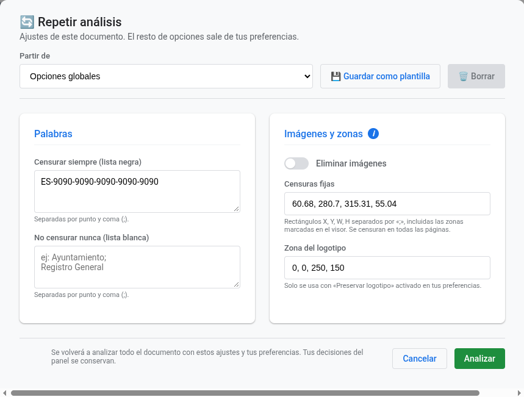

Imagen: Ventana Repetir análisis.

## 5.2. Punto de partida y plantillas

Las plantillas permiten guardar los ajustes de esta ventana y reutilizarlos con documentos del mismo modelo, por ejemplo, una autoliquidación, un certificado o una resolución de concesión de ayudas.

En la parte superior de la ventana se encuentran:

- **Partir de:** carga en la ventana los valores de **Opciones globales**, que son los de sus preferencias, o los de una plantilla guardada. Lo que la plantilla no incluya se toma de sus preferencias. Al cambiar el punto de partida se sustituyen los valores de la ventana, salvo los cambios pendientes del visor, que se conservan.
- **Guardar como plantilla:** guarda los valores actuales de la ventana como una nueva plantilla. La aplicación le pedirá un nombre, por ejemplo, «Liquidaciones» o «Nóminas».
- **Actualizar plantilla:** sustituye al botón anterior cuando hay una plantilla seleccionada. Reemplaza el contenido de esa plantilla por los valores actuales de la ventana.
- **Borrar:** elimina la plantilla seleccionada, previa confirmación. Tras borrarla, la ventana carga las opciones globales.

Al abrir la ventana, **Partir de** muestra la plantilla de la que procede el documento, si la hay. Los valores que se muestran son, en todo caso, los actuales del documento.

En esta versión, las plantillas se aplican desde esta ventana; no se aplican automáticamente a los documentos que se suben.

Ejemplo: el área de firma de los certificados de empadronamiento de su ayuntamiento ocupa siempre la misma posición, y el nombre del Ayuntamiento no debe ocultarse. La primera vez:

1. Revise un certificado y marque el área de firma con **Marcar zona** (apartado 4.3).
2. Pulse **Repetir análisis**: la zona marcada ya figura en **Censuras fijas**.
3. Añada `Ayuntamiento de Ejemplo` a la lista blanca.
4. Pulse **Guardar como plantilla** e indique el nombre «Certificados de empadronamiento».
5. Pulse **Analizar**.

Con los siguientes certificados, abra la revisión, pulse **Repetir análisis**, seleccione «Certificados de empadronamiento» en **Partir de** y pulse **Analizar**.

Para los modelos de documento que se procesan con frecuencia, se recomienda crear una plantilla por modelo y comprobarla con varios documentos antes de utilizarla de forma habitual. Antes de guardar una plantilla, retire de la lista negra los datos propios de un expediente concreto, que no deben aplicarse a otros documentos.

## 5.3. Listas de palabras

- **Censurar siempre (lista negra):** términos que se ocultan siempre, en todo el documento. Sepárelos con punto y coma (;). Los textos añadidos desde el visor con **Censurar siempre** se incorporan a esta lista.

  Ejemplo: `confidencial; reservado; expediente 2024/113`

- **No censurar nunca (lista blanca):** términos que no deben ocultarse aunque se detecten, como el nombre del organismo, un cargo o el nombre de una persona que debe figurar en el documento. Sepárelos con punto y coma (;). No se distinguen las letras acentuadas. Los términos se respetan en todo el documento, por lo que conviene evitar nombres que puedan coincidir con los de otras personas.

  Ejemplo: `Ayuntamiento de Ejemplo; Jefe de Servicio de Recaudación; Plaza Mayor, 1`

Los usuarios con conocimientos técnicos pueden utilizar expresiones regulares en la lista blanca anteponiendo el prefijo `regex:`.

## 5.4. Imágenes y zonas

- **Eliminar imágenes:** elimina de la versión definitiva las fotografías, gráficos e imágenes incrustadas, salvo las situadas en la zona del logotipo cuando está activada la opción **Preservar logotipo** y las que ocupan casi toda la página, como fondos o páginas escaneadas. Para este documento, este valor sustituye al de sus preferencias.
- **Censuras fijas:** zonas que se ocultan siempre, con independencia de su contenido, como las áreas de firma o los sellos de registro. Indique cada zona con sus valores X, Y, W y H separados por comas, y separe las zonas con punto y coma (;). Las zonas se aplican a todas las páginas. Este campo incluye también las zonas marcadas en el visor. El orden de las zonas en el campo determina su identificador en el panel de detecciones: la primera es Z1, la segunda Z2, y así sucesivamente.

  Ejemplo: `540, 0, 55, 842; 0, 722, 595, 120` (margen derecho completo y cabecera de la página).

- **Zona del logotipo:** posición y tamaño de la zona del logotipo, con cuatro valores X, Y, W, H separados por comas. Su contenido no se oculta ni se elimina. Solo se tiene en cuenta si la opción **Preservar logotipo** está activada en sus preferencias (apartado 6.5). Si se deja vacía, no se reserva ninguna zona para el logotipo.

  Ejemplo: `0, 700, 200, 142` (esquina superior izquierda de una página A4, donde suelen ubicarse los escudos institucionales).

Si un valor no tiene el formato correcto, el campo se resalta y se indica cómo corregirlo, por ejemplo: «Formato incorrecto. Usa 4 números: X, Y, W, H.».

El icono **(i)** muestra una tabla de zonas de referencia sobre una página A4, que puede utilizar como punto de partida:

| Zona | Coordenadas (X, Y, W, H) |
| :--- | :--- |
| Cabecera Alta | `0, 722, 595, 120` |
| Cabecera Alta Izquierda | `0, 742, 150, 100` |
| Logotipo | `0, 700, 200, 142` |
| Margen Derecho | `540, 0, 55, 842` |
| Margen Izquierdo | `0, 0, 145, 842` |
| Pie de Página | `0, 0, 595, 100` |
| Zona Central | `100, 200, 395, 442` |

## 5.5. Sistema de coordenadas

Las coordenadas de las censuras fijas y de la zona del logotipo siguen el sistema de los documentos PDF:

- **Origen:** el punto (0, 0) se encuentra en la esquina inferior izquierda de la página. El eje X avanza hacia la derecha y el eje Y, hacia arriba, a diferencia de muchos programas de diseño, en los que Y crece hacia abajo.
- **Rectángulo:** X e Y indican la esquina inferior izquierda de la zona; W, su ancho, y H, su alto.
- **Unidades:** puntos tipográficos. Un punto equivale a 1/72 de pulgada, aproximadamente 0,353 mm. Para convertir milímetros en puntos, multiplique por 2,835.
- **Tamaño de página:** una hoja A4 en vertical mide 595 × 842 puntos (210 × 297 mm); en horizontal, 842 × 595 puntos.

**Ejemplo 1. Área de firma en la parte inferior derecha.** Sobre el documento impreso se comprueba con una regla que el área de firma comienza a 12 cm del borde izquierdo y a 1,5 cm del borde inferior, y que mide 7,5 cm de ancho por 3 cm de alto:

| Valor | Cálculo | Resultado |
| :--- | :--- | :--- |
| X | 120 mm × 2,835 | 340 |
| Y | 15 mm × 2,835 | 43 |
| W | 75 mm × 2,835 | 213 |
| H | 30 mm × 2,835 | 85 |

La zona es `340, 43, 213, 85`. Se recomienda añadir un pequeño margen de seguridad, de unos 5 puntos por cada lado: `335, 38, 223, 95`.

**Ejemplo 2. Banda superior medida desde arriba.** Para ocultar una banda de 4 cm de alto en la parte superior de la página, calcule primero el alto: 40 mm × 2,835 = 113 puntos. Como el eje Y se mide desde abajo, la banda comienza en Y = 842 − 113 = 729. La zona es `0, 729, 595, 113`.

**La forma más sencilla** de obtener unas coordenadas es marcar la zona directamente en el visor con **Marcar zona** (apartado 4.3). La aplicación calcula sus coordenadas, que aparecen en el panel de detecciones y en el campo **Censuras fijas** de esta ventana, desde donde puede copiarlas a una plantilla o a sus preferencias.

Estos son los valores habituales del estándar. El sistema de coordenadas puede presentar variaciones según el origen del PDF o la herramienta con la que se generó, por ejemplo, si el documento tiene un tamaño distinto de A4, páginas giradas, desplazamientos o recortes. Compruebe siempre el resultado en la vista previa.

# 6. Preferencias de procesamiento

Sus preferencias de procesamiento definen cómo se analizan sus documentos. Se aplican a los documentos que suba a partir del momento en que las guarde y a los análisis que repita después; no modifican los documentos ya procesados.

## 6.1. Menú de usuario

En la esquina superior derecha se muestra su dirección de correo electrónico. Al pulsar sobre ella se despliega un menú con las opciones:

- **Mi cuenta:** datos personales y cambio de contraseña (al menos 12 caracteres).
- **Configuración:** preferencias de procesamiento.
- **Administración:** solo visible para administradores (apartado 7).
- **Cerrar sesión** (apartado 2.3).

Pulse **Configuración** para abrir la pantalla **Preferencias de procesamiento**, organizada en cinco pestañas: **General**, **Detección**, **Imágenes y rostros**, **Listas y zonas** y **Avanzado**.

Tras realizar cambios, pulse **Guardar cambios**. El botón solo se activa cuando hay cambios y todos los campos tienen un formato correcto. Al guardar, se muestra la confirmación «Preferencias guardadas correctamente». Si algún campo tiene un formato incorrecto, la pestaña que lo contiene muestra una marca y, al intentar guardar, la aplicación la abre para que pueda corregirlo.

Para salir, pulse **Volver**. Si hay cambios sin guardar, se le pedirá confirmación.

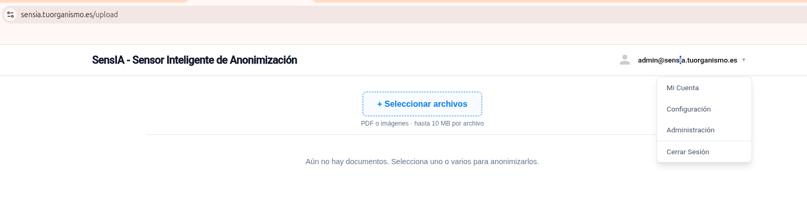

Imagen: Menú de usuario.

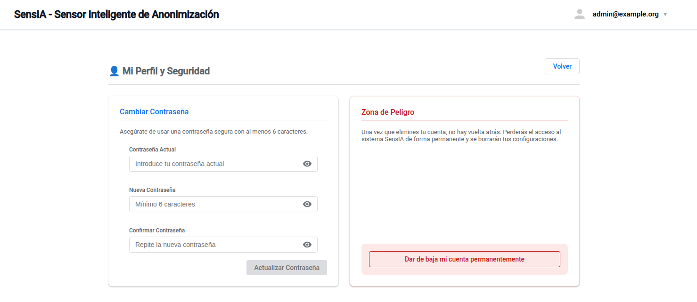

Imagen: Opciones de la cuenta de usuario.

## 6.2. General

| Opción | Descripción |
| :--- | :--- |
| **Vista previa antes de confirmar** | Cada documento queda pendiente de revisión antes de generar la versión definitiva. Define el modo de trabajo (apartado 1.1). Se recomienda mantenerla activada. |
| **Grosor del tachado** | Control deslizante, de -5 a 5, que ajusta el grosor del tachado aplicado sobre el texto. Compruebe su efecto en la vista previa antes de modificarlo de forma permanente. |
| **Anonimizar con seudónimos** | Sustituye los datos detectados por seudónimos en lugar de ocultarlos. |

**Seudónimos.** Con **Anonimizar con seudónimos**, los datos detectados se sustituyen por un seudónimo en lugar de ocultarse con un recuadro. El mismo dato recibe el mismo seudónimo en todo el documento, lo que permite seguir el contenido sin identificar a las personas. La información seudonimizada puede seguir considerándose dato personal, por lo que esta opción no equivale a una anonimización.

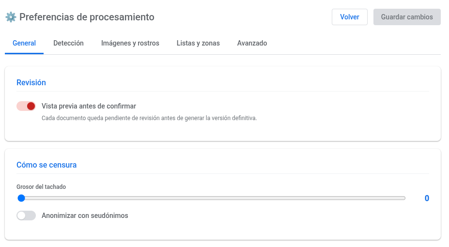

Imagen: Preferencias de procesamiento, pestaña General.

## 6.3. Detección

| Opción | Descripción |
| :--- | :--- |
| **Nombres propios** | Busca nombres y apellidos mediante el diccionario. |
| **Códigos QR** | Busca y oculta códigos QR y códigos de barras. |
| **Personas** (NER) | Busca nombres de personas mediante reconocimiento de entidades. |
| **Organizaciones** (NER) | Busca nombres de organizaciones. |
| **Lugares** (NER) | Busca nombres de lugares. |
| **Otras entidades** (NER) | Busca otras entidades. |

**Reconocimiento de entidades (NER).** Estas opciones solo están disponibles si su instalación dispone de este componente. Complementan la detección por diccionario mediante un modelo de lenguaje. El umbral de confianza que determina qué detecciones se aceptan se ajusta en la pestaña **Avanzado** (apartado 6.6).

Los nombres de organizaciones y lugares suelen corresponder a información pública, como el nombre del propio organismo o del municipio, y el modelo puede marcar también fragmentos de palabras. Si activa estas categorías, revise los resultados con atención y añada a la lista blanca los términos públicos que se repitan en sus documentos (apartado 6.5).

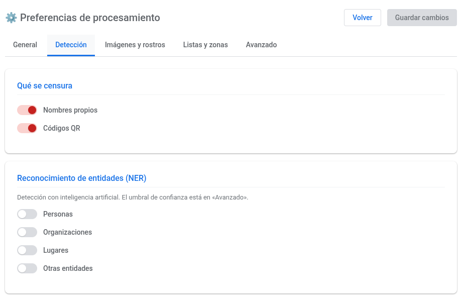

Imagen: Preferencias de procesamiento, pestaña detección.

## 6.4. Imágenes y rostros

- **Enmascarar rostros:** activa o desactiva la detección y ocultación de rostros.
- **Intensidad de pixelado:** control deslizante que ajusta la intensidad del pixelado de los rostros. Hacia la derecha, el pixelado es más intenso: el mosaico pasa de 16 a 4 bloques en el lado mayor de la zona oculta y, con 100, la zona se rellena de un color sólido. En los rostros pequeños los bloques tienen un tamaño mínimo, por lo que el mosaico tiene menos; los muy pequeños se rellenan de color. Se oculta también un margen del 20 % alrededor del rostro. Por defecto, 70.
- **Eliminar imágenes:** elimina de la versión definitiva las imágenes incrustadas, salvo las situadas en la zona del logotipo cuando está activada **Preservar logotipo** y las que ocupan casi toda la página, como fondos o páginas escaneadas.

Los filtros y parámetros del detector facial se encuentran en la pestaña **Avanzado** (apartado 6.6).

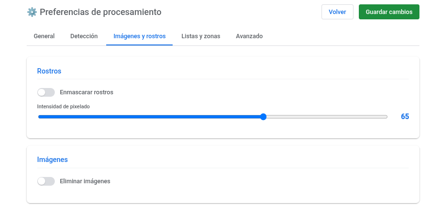

Imagen: Preferencias de procesamiento, pestaña Imágenes y rostros.

## 6.5. Listas y zonas

Las listas y zonas de esta pestaña se aplican a todos sus documentos. Tienen el mismo formato que en la ventana **Repetir análisis** (apartados 5.3 a 5.5) y son los valores que esta carga al seleccionar **Opciones globales**.

- **Censurar siempre (lista negra)** y **No censurar nunca (lista blanca):** términos separados por punto y coma (;).
- **Censuras fijas:** rectángulos X, Y, W, H separados por punto y coma, que se ocultan en todas las páginas de todos los documentos.
- **Preservar logotipo:** protege la zona del logotipo; su contenido no se oculta ni se elimina.
- **Zona del logotipo:** cuatro valores X, Y, W, H. Déjela vacía si sus documentos no tienen el logotipo en una posición fija.

El icono **(i)**, junto al título **Zonas**, muestra la tabla de zonas de referencia (apartado 5.4).

Ejemplo de configuración para un ayuntamiento:

| Campo | Valor |
| :--- | :--- |
| **Censurar siempre (lista negra)** | `confidencial; reservado` |
| **No censurar nunca (lista blanca)** | `Ayuntamiento de Ejemplo; Concejalía de Hacienda; Plaza Mayor, 1` |
| **Censuras fijas** | Vacío: las áreas de firma se definen por modelo, en plantillas. |
| **Preservar logotipo** | Activado |
| **Zona del logotipo** | `0, 700, 200, 142` |

Defina aquí solo las reglas comunes a todos sus documentos. Las propias de un modelo concreto, como el área de firma de un certificado, es preferible guardarlas en una plantilla (apartado 5.2).

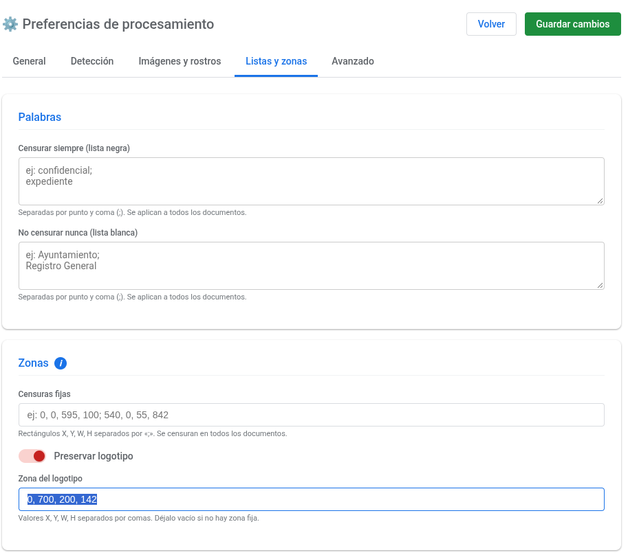

Imagen: Preferencias de procesamiento, pestaña Listas y zonas.

## 6.6. Avanzado

Esta pestaña reúne los parámetros de los motores de detección. Se recomienda modificarlos solo si conoce su efecto sobre el resultado o si se observan problemas de detección.

**Entidades (NER)**

- **Umbral de confianza:** valor entre 0 y 1 que determina qué detecciones del reconocimiento de entidades se aceptan. Un valor más bajo detecta más entidades, pero también más falsos positivos; uno más alto reduce los falsos positivos, a cambio de más omisiones. Por defecto, 0,65. Se recomienda ajustarlo según los documentos que se procesen, en pasos de 0,05.

**Filtros de rostros**

- **Min Aspect Ratio / Max Aspect Ratio:** proporción mínima y máxima entre ancho y alto de las detecciones. El valor 0 desactiva el filtro.
- **Min Face Area / Max Face Area:** área mínima y máxima, en píxeles de la imagen original, de los rostros que se procesan. El valor 0 desactiva el filtro.

Los filtros permiten descartar detecciones que no corresponden a rostros. Tenga en cuenta que un área mínima elevada puede dejar sin ocultar rostros de personas que aparecen en segundo plano.

**Motor de rostros (YuNet)**

- **Score Threshold:** confianza mínima, entre 0 y 1, para considerar que un elemento es un rostro. Por defecto, 0,3. Un valor más bajo detecta más rostros, por ejemplo, de perfil o con poca luz, pero también más falsos positivos.
- **NMS Threshold:** evita que se marquen varios recuadros sobre un mismo rostro. Por defecto, 0,45.
- **Top K:** número máximo de candidatos que se evalúan en cada imagen. Por defecto, 5000. Normalmente no es necesario modificarlo.

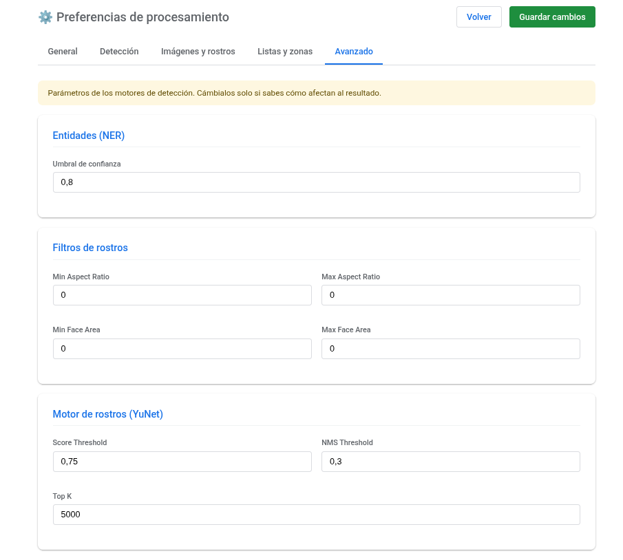

Imagen: Preferencias de procesamiento, pestaña Avanzado.

# 7. Administración

Este apartado solo está disponible para los usuarios con rol de administrador. Para acceder, despliegue el menú de usuario y pulse **Administración**. Se abrirá el **Panel de Control Administrativo**. Los cambios se aplican de inmediato, sin necesidad de reiniciar el servidor.

## 7.1. Controles globales

En la parte superior del panel se encuentran cuatro interruptores:

- **Modo de mantenimiento.** Su etiqueta indica el estado actual: **Sitio ACTIVO** en funcionamiento normal y **Sitio NO ACTIVO** cuando el modo de mantenimiento está activado. En mantenimiento, los usuarios que no son administradores no pueden acceder y la pantalla de inicio de sesión muestra un aviso. Además, el equipo técnico puede activar un mantenimiento completo desde la configuración del servidor; en ese caso, el formulario de acceso queda deshabilitado para todos los usuarios.
- **Registro activo:** muestra u oculta el enlace de registro en la pantalla de inicio de sesión. Como las credenciales se envían por correo electrónico, requiere que la instalación tenga configurado el envío de correo. Desactívelo si las cuentas deben crearse solo desde la administración.
- **Recuperar Contraseña:** habilita o deshabilita la recuperación de contraseña mediante código temporal (apartado 2.2). Requiere que la instalación tenga configurado el envío de correo.
- **Captcha activo:** activa o desactiva la verificación ALTCHA en las pantallas de acceso, registro y recuperación de contraseña. Se recomienda mantenerla activada si la aplicación es accesible desde Internet.

Antes de activar el modo de mantenimiento, se recomienda avisar con antelación a los usuarios, para que puedan descargar los documentos en los que estén trabajando.

## 7.2. Gestión de usuarios

Debajo de los controles globales se muestra la lista de usuarios, con las columnas **Usuario**, **Email**, **Rol**, **Estado** (**Activo** o **Bloqueado**) y **Acciones**. Las cuentas bloqueadas se muestran resaltadas.

- **Crear Usuario:** abre la ventana **Nuevo Usuario** para dar de alta una cuenta.
- **Acciones (⋮):** despliega las opciones **Editar**, **Bloquear** (o **Desbloquear**) y **Eliminar**.

Las ventanas **Nuevo Usuario** y **Editar Usuario** contienen:

- **Usuario:** identificador del usuario.
- **Email:** correo electrónico, que se utiliza para iniciar sesión.
- **Rol:** **Usuario** o **Admin**. El rol **Admin** permite, además, acceder a este panel.
- **Contraseña:** junto al campo hay tres botones para generar una contraseña aleatoria (↻), copiarla al portapapeles y mostrarla u ocultarla.

Pulse **Crear Usuario** o **Guardar Cambios** para aplicar los cambios, o **Cancelar** para cerrar la ventana sin guardar. El botón de guardar solo se activa cuando todos los campos obligatorios son correctos.

Un usuario bloqueado no puede iniciar sesión: al intentarlo, verá el mensaje «Tu cuenta está bloqueada. Contacta con soporte.». Bloquear una cuenta es una medida reversible; eliminarla, no.

Recomendaciones:

- Asigne el rol de administrador solo a las personas que lo necesiten.
- Utilice el botón ↻ para generar contraseñas robustas. Comuníquelas por un canal seguro, distinto del utilizado para facilitar el correo de acceso, y pida al usuario que la cambie en su primer acceso, desde **Mi cuenta**.
- Bloquee las cuentas de las personas que dejen de necesitar acceso de forma temporal, y elimine las que ya no vayan a utilizarse.

Pulse **Volver** para regresar a la bandeja de trabajo.

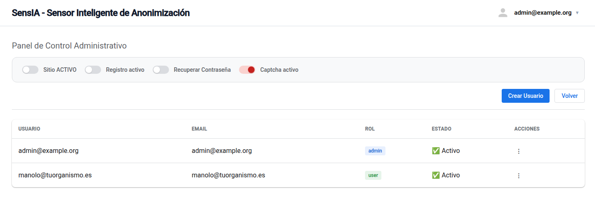

Imagen: Panel de control administrativo.

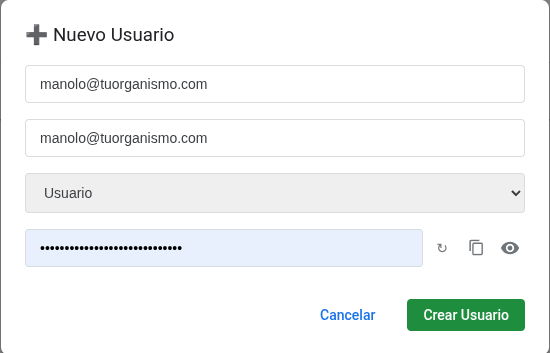

Imagen: Alta de un usuario.

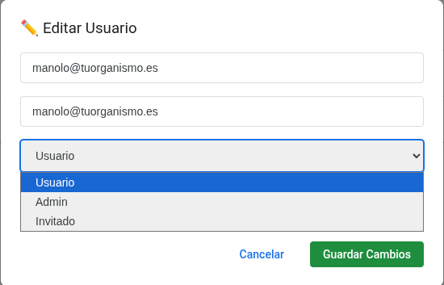
Imagen: Edición de un usuario.

# 8. Recomendaciones de uso y limitaciones conocidas

## 8.1. Recomendaciones

- **Mantenga activada la vista previa** en sus preferencias. Utilice el modo sin vista previa solo con modelos de documento cuyas reglas haya comprobado previamente.
- **Compruebe siempre el resultado antes de publicarlo:** en la pantalla de revisión, si trabaja con vista previa, y con el comparador antes de descargar.
- **Complete la revisión antes de volver a la bandeja.** Si sale después de haber aplicado cambios, al volver a revisar el documento se analizará desde el principio (apartado 4.4).
- **Utilice plantillas** para los modelos que procesa con frecuencia: zonas fijas para las firmas, lista blanca para el nombre del organismo y eliminación de imágenes cuando no sean necesarias (apartado 5.2).
- **Añada a la lista blanca los datos públicos que se repiten**, como la dirección o el teléfono de una oficina, en lugar de desactivarlos en cada documento.
- **Aproveche las acciones sobre todas las apariciones:** con **Mayús** y clic sobre un interruptor, el cambio se aplica a todas las apariciones del mismo elemento (apartado 4.2).
- **Oculte los códigos QR y los códigos de verificación** que permitan descargar el documento original.
- **Revise el nombre del archivo.** La versión definitiva se descarga con el nombre original precedido de `CENSURADO_`, por lo que no debe contener datos personales.
- **Descargue los resultados antes de cerrar la sesión**, ya que la bandeja se vacía al salir.
- **Suba solo los documentos que necesite anonimizar** y elimínelos de la bandeja cuando ya no los necesite.

## 8.2. Limitaciones conocidas

| Situación | Qué puede ocurrir | Cómo actuar |
| :--- | :--- | :--- |
| Códigos QR situados junto a bordes o líneas de tabla | Pueden no detectarse. | Revise estas zonas y cubra los que falten con **Marcar zona**. Si el código se repite en la misma posición en un modelo de documento, defina una censura fija en su plantilla; si está incluido como imagen, puede usar **Eliminar imágenes**. |
| Datos repartidos en varias líneas dentro de una celda de tabla | Pueden detectarse solo en parte o no detectarse. | Revise las tablas con atención. Seleccione el dato en el visor y pulse **Censurar siempre**, o cúbralo con **Marcar zona**. |
| Documentos escaneados de baja resolución | El OCR puede no reconocer todo el texto. | Revise el documento completo y cubra con **Marcar zona** los datos no reconocidos. Si es posible, escanéelo de nuevo a una resolución de al menos 300 ppp. |
| Texto dentro de imágenes de baja resolución | Puede no ocultarse. | Utilice **Eliminar imágenes** o cubra la imagen con **Marcar zona**. |
| Imágenes JPG y PNG | Solo se detectan rostros; el texto que contengan no se analiza. | Si la imagen contiene texto con datos personales, conviértala a PDF antes de subirla: así podrá aplicar el OCR, las listas y las zonas. |
| Reconocimiento de entidades (NER) | Puede marcar datos públicos o fragmentos de palabras. | Revise las detecciones de tipo **Entidad** y añada los términos públicos a la lista blanca. |
| Documentos que combinan páginas con texto y páginas escaneadas | La necesidad de OCR se decide con la primera página: si tiene texto, las páginas escaneadas posteriores no se analizan. | Revise esas páginas y cubra los datos con **Marcar zona**, o súbalas como un PDF aparte. |

## 8.3. Ejemplo completo de trabajo

El siguiente ejemplo recorre el tratamiento, antes de su publicación, de una resolución de concesión de subvenciones de seis páginas que incluye un anexo con las personas beneficiarias.

1. **Preparación.** Compruebe que el nombre del archivo no contiene datos personales, por ejemplo, `Resolucion_subvenciones_2026_015.pdf`.
2. **Subida.** Pulse **+ Seleccionar archivos** y elija el documento. Su estado pasa por **En cola…** y **Procesando…** hasta **Pendiente de revisión**.
3. **Revisión de detecciones.** Pulse **Revisar**. El nombre del concejal que firma la resolución aparece en todas las páginas y debe publicarse: mantenga pulsada **Mayús** y pulse su interruptor para desactivarlo en todas ellas.
4. **Área de firma.** En la última página, pulse **Marcar zona** y trace un rectángulo sobre la firma manuscrita.
5. **Plantilla.** Como este modelo se publica cada mes, pulse **Repetir análisis**: la zona marcada ya figura en **Censuras fijas**. Añada `Ayuntamiento de Ejemplo; Plaza Mayor, 1` a la lista blanca, pulse **Guardar como plantilla**, indique el nombre «Resoluciones de subvenciones» y pulse **Analizar**.
6. **Ajustes del documento.** Tras el nuevo análisis, que conserva la decisión del paso 3, desactive la zona de firma en las páginas 1 a 5, en las que no hay firma. En el anexo, un NIF repartido en dos líneas de una celda solo se ha detectado en parte: selecciónelo en el visor, pulse **Censurar siempre** y, después, **Aplicar**.
7. **Comprobación y confirmación.** Recorra todas las páginas, pulse **Actualizar vista previa** si ha cambiado algún interruptor y, por último, **Confirmar**.
8. **Comparación y descarga.** Cuando el documento esté **Listo para descargar**, pulse **Comparar**, verifique el resultado y pulse **Descargar**. Obtendrá el archivo `CENSURADO_Resolucion_subvenciones_2026_015.pdf`.
9. **Limpieza.** Elimine el documento de la bandeja.

El mes siguiente, tras subir la nueva resolución, bastará con abrir la revisión, pulsar **Repetir análisis**, seleccionar «Resoluciones de subvenciones» en **Partir de** y pulsar **Analizar**.

## 8.4. Preguntas frecuentes

**¿Por qué no aparece el botón Comparar?**
Solo aparece cuando el documento está **Listo para descargar**. Mientras está pendiente de revisión, utilice el selector **Anonimizado | Original** de la pantalla de revisión.

**¿Por qué no puedo seleccionar texto en el visor?**
Puede deberse a que se muestra la versión definitiva, que no conserva el texto: cambie el selector a **Original**. También ocurre en los documentos escaneados sin capa de texto; en ese caso, utilice **Marcar zona**. En las imágenes JPG y PNG no es posible seleccionar texto ni marcar zonas.

**¿Por qué está desactivado el botón Confirmar?**
Porque hay cambios del visor pendientes de aplicar, el documento se está procesando o todavía no tiene resultado. En un documento procesado sin vista previa, se activa cuando modifica alguna detección.

**He cambiado mis preferencias. ¿Afectan a los documentos que ya están en la bandeja?**
No. Se aplican a los documentos que suba después y a los análisis que repita. Para aplicarlas a un documento ya procesado, repita su análisis (apartado 5) o vuelva a revisarlo desde el principio (apartado 4.4).

**Al pulsar Revisar, la aplicación me pide confirmación para analizar de nuevo el documento. ¿Por qué?**
Porque en una revisión anterior aplicó cambios a ese documento. Si acepta, se descartan esos cambios y el documento se analiza desde el principio (apartado 4.4).

**Un documento permanece mucho tiempo en estado En cola…**
El servidor está atendiendo otros documentos y procesará el suyo en cuanto haya capacidad disponible. Puede seguir trabajando con otros documentos mientras tanto. Si la espera se prolonga de forma anómala, comuníquelo al servicio de soporte.

**¿Qué ocurre con mis documentos si cierro la sesión?**
La bandeja se vacía y se interrumpe el procesamiento en curso. Descargue antes las versiones definitivas que necesite.

**¿Cómo aplico una plantilla a un documento nuevo?**
Suba el documento, ábralo con **Revisar**, pulse **Repetir análisis**, seleccione la plantilla en **Partir de** y pulse **Analizar**.

**La imagen que he subido contiene datos personales escritos y no se han ocultado.**
En las imágenes JPG y PNG solo se detectan rostros. Convierta la imagen a PDF y súbala de nuevo: así podrá aplicar el OCR, las listas y las zonas.
